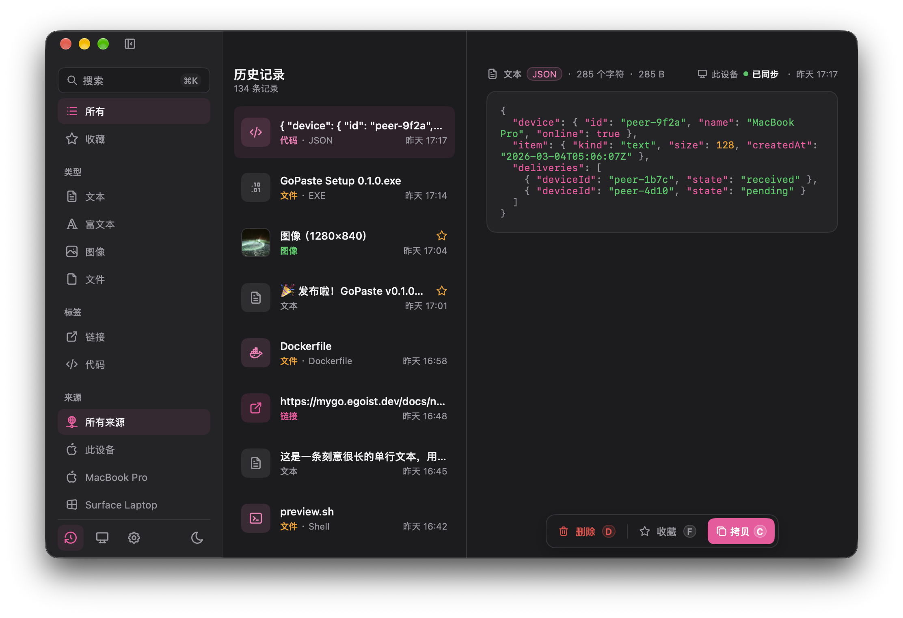

# GoPaste

局域网直连的剪贴板历史工具，用 Go 和 [MyGo](https://mygo.egoist.dev) 写原生界面。



*这张图是用示例数据跑出来的，侧栏的设备列表和"已同步"标记都还是假的。*

## 设计约束

下面三条是硬约束，不是待办事项：

- **只走局域网直连。** 没有内置中继、云服务、第三方代理，也没有任何非局域网的回退连接。
- **剪贴板内容不出本机。** 不写普通日志，不做遥测，不发给任何第三方服务。
- **原生界面。** 保持 MyGo 原生窗口和控件，不引入 WebView 或独立前端框架。

## 当前状态

剪贴板捕获、本地历史和界面已经能用，**局域网同步还没做**：设备页和配对对话框目前只有界面，不会假装配对成功。

已经能用的部分：

- 剪贴板监听，自动区分文本、富文本、图片、文件和代码片段；用内容摘要当 ID，同样的内容不会存两份
- 跳过密码管理器标记的敏感内容，不记进历史
- 本地 SQLite 历史，写入排队执行，退出时不丢刚复制的那条
- 搜索、按类型 / 标签 / 来源筛选、收藏、删除、撤销
- 预览图片、文件路径和代码语法高亮（chroma）
- 系统托盘、窗口快捷键、界面缩放
- 简体中文 / English 双语，跟随系统或手动固定；浅色 / 深色 / 跟随系统

## 运行

需要 Go 1.27.1 或更高版本。

```sh
go run .              # 直接运行
go tool mygo dev      # 开发模式，带热重载
go tool mygo build    # 打包，macOS 产出 .app 和 .dmg
```

想先看看界面长什么样，运行 `scripts/preview.sh`：它先用 `scripts/mockdb` 造一批示例历史，再启动开发版应用。示例数据只写在本机 `.preview/history.db`，不会提交到仓库。

历史数据库默认放在用户数据目录下，macOS 是 `~/Library/Application Support/GoPaste/history.db`。`-db PATH` 或 `GOPASTE_HISTORY_DB` 可以改到别处，路径必须是绝对路径；应用启动的第一行日志会报出它实际用的文件。

## 开发

```sh
go fmt ./...
go tool mygo vet .
CGO_ENABLED=0 go test ./...
```

`internal/` 下的包不依赖 MyGo，也不依赖网络，可以脱离界面单独测试：

| 包 | 职责 |
| --- | --- |
| `internal/capture` | 把剪贴板变化变成历史条目：合并一次复制的多次通知、读取、分类、决定是否保留 |
| `internal/clipboard` | 唯一直接调用剪贴板库的地方，负责处理各平台格式不一样的问题 |
| `internal/history` | 历史数据与用户可见的操作，含筛选、排序，以及每条记录发给了哪些设备 |
| `internal/history/sqlite` | `history.Repository` 的 SQLite 实现，纯 Go 驱动，CGO 关闭也能构建 |
| `internal/syntax` | 猜代码片段是什么语言，再用 chroma 切成一段段好上色 |
| `internal/filetype` | 按文件名判断类型，决定图标、颜色和标签 |

平台相关代码集中在 `tray.go`、`persistence.go`、`runtime.go` 和 `state.go`。

## 许可证

MIT，全文见 [LICENSE](LICENSE)。

`resources/icons/` 里的图标取自 [Tabler Icons](https://github.com/tabler/tabler-icons)（MIT）和 [Simple Icons](https://simpleicons.org)（CC0），各自的许可证全文放在同目录下。
